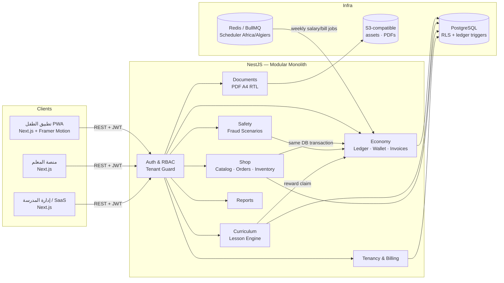
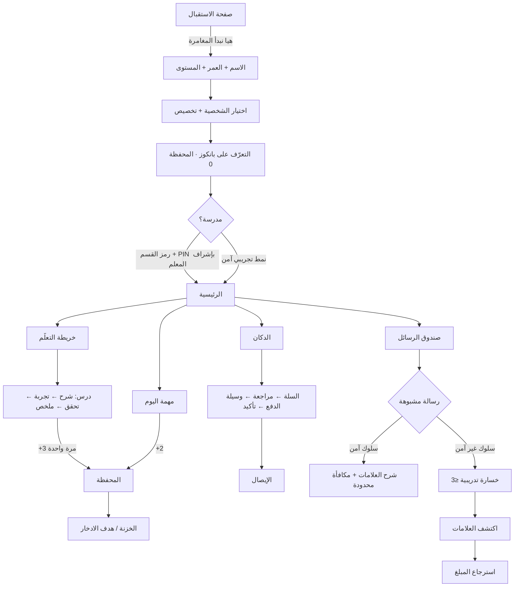
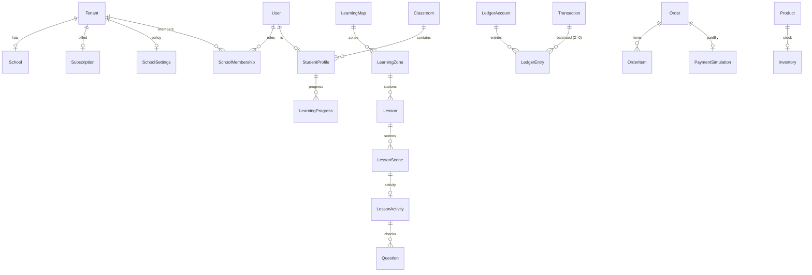

# BANKOO — بنكوو · حزمة المعمارية والتخطيط (v0.1)

> الوثيقة المرجعية للمرحلة 1 (Discovery & Architecture). تتبع ترتيب البند 29 من الـ Master Prompt.
> الحالة الفعلية لكل جزء موضّحة في القسم 13 «ما اكتمل وما لم يكتمل».

---

## 1. ملخص فهمي للمشروع

بنكوو منصة SaaS تعليمية جزائرية تعلّم الأطفال (6–16 سنة) الثقافة المالية والدفع الإلكتروني عبر **اقتصاد صفّي افتراضي**: يبدأ الطفل برصيد 0 بانكوز، ويكسب بالتعلّم والمهام والراتب الأسبوعي، ويدفع فواتير، ويدّخر لهدف، ويتسوّق من دكان يديره المعلم، ويتدرّب على كشف الاحتيال. السنجاب «بنكوو» هو المرشد الدائم.

ثلاث طبقات منتج:
1. **تطبيق الطفل (PWA)**: عالم مرسوم، خريطة تعلّم، دروس قصيرة، محفظة، دكان، صندوق رسائل.
2. **منصة المعلم**: الأقسام، الدروس والمهام، سياسة الاقتصاد، الدكان، التقارير والمطبوعات.
3. **منصة المدرسة وإدارة SaaS**: مؤسسات متعددة معزولة، اشتراكات، صلاحيات، سجلات.

القيمة الجوهرية ليست «أسئلة ونقاط»، بل **قرار ← نتيجة مرئية في المحفظة ← شرح**. لذلك يُعامَل الاقتصاد الافتراضي بصرامة محاسبية حقيقية.

## 2. نقاط القوة والضعف في الفكرة الحالية

| نقاط القوة | نقاط الضعف / المخاطر | المعالجة المقترحة |
|---|---|---|
| تعلّم بالتجربة (اقتصاد صفّي) بدل الحفظ | خطر «اللعبنة» (Gamification) التي تكافئ النقر لا الفهم | فصل النجوم (تعلّم) عن بانكوز (اقتصاد)، مكافأة مرة واحدة لكل نشاط، سقف يومي |
| هوية بصرية قوية ومتّسقة (السنجاب + شخصيات المجتمع) | الأصول الحالية لوحات مفاهيم: خلفيات، نصوص مطبوعة داخل الصور، ليست SVG/Lottie | تكليف رسام بنسخ شفافة + Rive/Lottie للحالات العشر؛ الإبقاء على قصّات المرحلة 1 مؤقتًا |
| محاكاة احتيال آمنة — حاجة حقيقية | قد تُقرأ كتخويف أو «عقاب» | خسارة محدودة (≤3) لا تتجاوز الرصيد، قابلة للاسترجاع بالتعلّم، يمكن للمعلم تعطيلها |
| ملاءمة محلية (الدينار، الماء، الكهرباء، CIB، الذهبية) | معلومات وسائل الدفع الجزائرية تتغيّر | طبقة محتوى «يتطلب تحقّقًا» + مراجعة قبل النشر (حقل `reviewedBy` في `Lesson`) |
| نموذج SaaS مدارس | دورة بيع بطيئة للمدارس؛ متطلبات قانونية للأطفال | نمط تجريبي بلا بيانات شخصية، تجربة مجانية للقسم، مراجعة قانونية قبل الإطلاق (القانون 18-07 لحماية المعطيات الشخصية) |
| الراتب/الفاتورة الأسبوعية تعلّم الميزانية | تنفيذ مكرر عند إعادة تشغيل الخادم | مفاتيح Idempotency لكل (طالب، أسبوع) — مُختبرة |
| — | خريطة الصورة المرجعية (24 محطة) تختلف عن قائمة البرومبت (22) | اعتمدت خريطة الصورة كمصدر الحقيقة؛ المحتوى مربوط بمعرّفات لا بأرقام |

## 3. المعمارية (Architecture Diagram)



قرارات معمارية رئيسية:
- **Modular Monolith** (NestJS modules) بقاعدة PostgreSQL واحدة: كل عمليات المال والمخزون تحتاج معاملة ذرية واحدة؛ الخدمات المصغّرة هنا تعقيد بلا فائدة.
- **العزل متعدد المستأجرين على مستويين**: Guard في الـ API يتحقق من `tenantId` لكل طلب + **Row-Level Security** في PostgreSQL (`prisma/ledger_guards.sql`). إخفاء عناصر الواجهة ليس حماية.
- **الدفتر المالي هو مصدر الحقيقة**: لا يوجد حقل «رصيد» قابل للتعديل؛ الرصيد = مجموع القيود. القيود append-only بقادح (trigger) في قاعدة البيانات.
- **الجدولة على الخادم فقط** (BullMQ + cron بتوقيت `Africa/Algiers`)، ومفاتيح idempotency تجعل إعادة التشغيل آمنة.
- **PWA أولًا** مع API موثّق (OpenAPI) يسمح بتطبيق Android/iOS لاحقًا.

## 4. مسارات المستخدمين (User Flows)



**المعلم**: دخول بالبريد + كلمة مرور (argon2id) ← اختيار القسم ← لوحة المؤشرات ← (طلاب | دروس ومهام | اقتصاد | دكان | تقارير | مطبوعات). كل تعديل يدوي على رصيد يتطلب «سبب» ويُسجَّل في AuditLog.

**مسؤول المدرسة**: إنشاء الأقسام ← دعوة المعلمين ← سياسة الاقتصاد (الراتب، الفاتورة، الأيام، العطل، الاحتيال) ← التقارير.

**Super Admin**: المدارس والاشتراكات والباقات ← المحتوى العام (المنهج المرجعي) ← المراقبة والسجلات.

## 5. خريطة الواجهات (Sitemap)

```
/                         صفحة الاستقبال
/start/{name,avatar,coin} رحلة الإعداد
/join                     الدخول برمز القسم + PIN
/app/home                 الرئيسية
/app/map                  خريطة التعلّم
/app/lesson/:id           مشغّل الدرس (مشاهد/نشاط/أسئلة/تلميحات)
/app/missions/:id         المهمات
/app/wallet               المحفظة · /card · /savings · /invoices/:id · /statement
/app/shop                 الدكان · /product/:id · /cart · /receipt/:id
/app/inbox                الرسائل التدريبية · /fraud/:scenario
/app/me                   الملف، الشارات، الشهادات، الإعدادات

/teacher                  المؤشرات
/teacher/students · /classes · /lessons · /missions · /progress
/teacher/economy          الراتب، الفواتير، المعاملات، التعديلات
/teacher/shop · /orders   المنتجات والمخزون والطلبات
/teacher/printables · /reports · /settings

/school                   نظرة عامة · /teachers · /classes · /students · /policies · /reports · /roles
/admin                    المدارس · الاشتراكات · الباقات · المحتوى · المراقبة · السجلات
```

## 6. نظام التصميم (Design System)

**الألوان (Tokens)**

| Token | القيمة | الاستعمال |
|---|---|---|
| `--blue` | `#1854D6` | العلامة، الفقاعات، التنقّل |
| `--navy` | `#103B91` | فقاعات بنكوو، العناوين على الأزرق |
| `--orange` | `#F28C28` | الإجراء الرئيسي، المحطة التالية |
| `--yellow` | `#FFC83D` | المكافآت، الكلمة المميزة في الفقاعة |
| `--green` | `#35B879` | النجاح، المكتمل، الادخار |
| `--paper` | `#F8FAFF` | الخلفية الدافئة |
| `--ink` | `#182B49` | النص |
| `--red` | `#E5484D` | الأخطاء الحقيقية فقط وباعتدال |

**الخطوط**: Baloo Bhaijaan 2 (عناوين وأرقام) + Tajawal (قراءة). 4 مقاسات: 34/22/18/14.
**الأشكال**: بطاقات زجاجية بيضاء `radius 26px`، ظل أزرق ناعم، أزرار «حبة» برتقالية بعمق 6px، أهداف لمس ≥44px.
**المكوّنات**: `Bubble` (فقاعة بنكوو)، `MascotPose` (10 حالات)، `CoinBadge`، `BalanceCounter` (عدّاد متحرك)، `ProgressBar`، `OptionCard`، `SortBins`، `CoinCounter`، `VirtualCard`، `ProductTile`، `PaymentFlow` (5 مراحل)، `Receipt` (A4)، `MailItem`، `RedFlag`، `BottomNav` (5 عناصر).
**الحركة**: 180–350ms للتفاعلات، احتفالات أطول عند الإنجاز، `prefers-reduced-motion` يوقف كل الحركات.
**قواعد ثابتة**: لا رمز خنزير للادخار (خزنة زرقاء أو وعاء عملات)؛ لا Emoji بدل الشخصيات؛ عملة بانكوز تحمل رمز البنك لا حرف «B» (تجنّبًا لإيحاء العملات المشفّرة)؛ البطاقة الافتراضية بلا رقم من 16 خانة.

## 7. مخطط قاعدة البيانات

المخطط الكامل: [`prisma/schema.prisma`](../prisma/schema.prisma) (Prisma 7، مُتحقَّق منه بالمدقق الرسمي) + ضمانات قاعدة البيانات في [`prisma/ledger_guards.sql`](../prisma/ledger_guards.sql).



ملاحظات: كل جدول خاص بمستأجر يحمل `tenantId` ومفهرس عليه؛ الأطفال بلا بريد، ورمز دخول PIN مُجزّأ (hash) ومحدود المحاولات؛ `Plan.priceDzdMonth` للمدارس فقط ولا يظهر للأطفال أبدًا.

## 8. محرك الاقتصاد الافتراضي

التنفيذ المرجعي المختبَر: [`packages/economy`](../packages/economy).

**الحسابات** (لكل مدرسة): `SCHOOL_TREASURY` (مصدر الرواتب والمكافآت)، `SCHOOL_UTILITIES` (الفواتير)، `SCHOOL_SHOP` (المبيعات)، `FRAUD_SIM` (خسائر المحاكاة). ولكل طفل: `STUDENT_WALLET` و`STUDENT_SAVINGS` (ممنوع السالب).

**القيد المزدوج**: كل معاملة سطران أو أكثر مجموعها صفر. مثال الراتب: `TREASURY −10 / WALLET +10`. الشراء: `WALLET −8 / SHOP +8` + خصم المخزون **في المعاملة نفسها**.

**مفاتيح Idempotency** (فريدة لكل مدرسة):

| العملية | المفتاح | الضمان |
|---|---|---|
| الراتب | `salary:<student>:W<saturday-date>` | مرة واحدة أسبوعيًا مهما أُعيد تشغيل المجدول |
| الفاتورة | فاتورة فريدة `(student, UTILITIES, week)` + `invoice:<id>` | إصدار واحد، دفع واحد |
| مكافأة درس/مهمة | `reward:<student>:<activity>` + جدول `reward_claims` | إعادة الدرس مجانية، المكافأة مرة واحدة |
| الشراء | `order:<student>:<checkout-key>` | النقر المزدوج / إعادة الإرسال لا يخصم مرتين |
| استرجاع الاحتيال | `fraud-recover:<attempt>` | استرجاع واحد، كقيد تعويضي يشير إلى الأصل |

**قواعد**: لا رصيد سالب (فحص داخل المعاملة + قادح DEFERRED في PostgreSQL)؛ لا حذف ولا تعديل للقيود (التصحيح بقيد `REVERSAL`)؛ تعديلات المعلم اليدوية تتطلب سببًا وتُسجَّل في AuditLog؛ سقف مكافآت يومي (افتراضي 20) ضد «الاستزراع»؛ إن لم يكفِ الرصيد للفاتورة تبقى «بانتظار السداد» بلا عقوبة ولا إحراج.

**التقويم**: أسبوع بنكوو يبدأ السبت (`Africa/Algiers`)؛ السبت 08:00 راتب 10، الأحد 08:00 فاتورة 4 (ماء 1 + كهرباء 2 + إنترنت 1). كل ذلك قابل للضبط لكل مدرسة ضمن حدود، مع العطل المدرسية.

## 9. خطة المنهج حسب العمر

الخريطة (حسب الصورة المرجعية): 6 مناطق × 4 محطات = 24.

| المنطقة | المحطات | 6–8 سنوات | 9–12 سنة | 13–16 سنة |
|---|---|---|---|---|
| 1 مدينة البدايات | ما هو المال؟ · ما هي بانكوز؟ · كيف نربح المال؟ · الحاجة أم الرغبة؟ | صور، عدّ، فرز بالسحب | + جمع بسيط، سبب استعمال المال | + المقايضة، الدخل والعمل |
| 2 غابة الادخار | لماذا ندخر؟ · هدف الادخار · قسّم مصروفك · اصبر لتشتري | عدّ القطع إلى الخزنة | + حساب الفرق للهدف | + خطة أسبوعية، نسب الادخار |
| 3 سوق بنكوو | الأسعار · أقارن قبل الشراء · السلة والفاتورة · شراء ذكي | الأرخص/الأغلى | + مقارنة سعر الوحدة، الباقي | + قراءة الفاتورة، العروض |
| 4 مدينة المدفوعات | ما هي البطاقة؟ · الدفع الإلكتروني · QR · الهاتف | بطاقة = مال في حساب | + مراحل الدفع، الإيصال | + CIB/الذهبية/TPE (بعد التحقق) |
| 5 قلعة الأمان | احمِ معلوماتك · اكتشف الاحتيال · الرسائل المشبوهة · اطلب المساعدة | «لا أشارك رمزي» | + علامات الخداع | + الروابط والمتاجر المقلّدة |
| 6 عالم المستقبل | ميزانيتك · فواتيرك · أنجز هدفك · المغامرة النهائية | — مبسّط — | ميزانية أسبوعية | ميزانية شهرية ومشروع |

كل درس = مشاهد 30–90 ثانية: **شرح ← تجربة تفاعلية ← سؤال تحقق ← (خطأ: تلميح، ثم شرح بمثال مختلف) ← ملخص ← مكافأة محدودة**. شرط الإكمال = إظهار الفهم لا سرعة الإجابة الأولى. المحتوى الذي يذكر وسائل دفع جزائرية حقيقية يمرّ بمراجعة قبل النشر.

## 10. Backlog مرتب حسب الأولوية

| # | العنصر | المرحلة | الحالة |
|---|---|---|---|
| P0 | محرك الدفتر المالي + الاختبارات الـ12 | 3 | ✅ مرجعي (SQLite) |
| P0 | مخطط Prisma + قوادح PG + RLS | 1 | ✅ مكتوب ومتحقَّق (لم يُشغَّل على PG بعد) |
| P0 | الشريحة الرأسية للطفل (استقبال ← درس ← مكافأة ← محفظة ← شراء) | 2–4 | ✅ نموذج يعمل بخادم تجريبي داخل المتصفح |
| P0 | NestJS API: Auth/RBAC/Tenant Guard + Economy module على PostgreSQL | 3 | ⏳ التالي |
| P0 | نقل الشريحة إلى Next.js + ربطها بالـ API | 2 | ⏳ |
| P1 | المجدول BullMQ (راتب/فاتورة/عطل/إعادة محاولة) | 3 | ⏳ (المنطق جاهز في `runWeekly`) |
| P1 | محرر/مستورد المحتوى (JSON → Lesson tables) + مراجعة تربوية | 3 | ⏳ |
| P1 | منصة المعلم: طلاب، أقسام، رموز دخول، دكان، تعديلات بسبب | 5 | ⏳ |
| P1 | المطبوعات PDF A4 RTL (إيصال، كشف، شهادة، فاتورة) | 5 | ⏳ (نسخ HTML للطباعة جاهزة) |
| P2 | المنطقتان 2 و3 كاملتان | 3–4 | ⏳ |
| P2 | أصول نهائية شفافة + Rive لحالات بنكوو العشر | 7 | ⏳ يحتاج رسامًا |
| P2 | منصة المدرسة + SaaS + الاشتراكات | 6 | ⏳ |
| P3 | فضاء ولي الأمر، الفرنسية، التطبيقات الأصلية | لاحقًا | — |

## 11. خطة MVP

**MVP = قسم واحد حقيقي يعمل أسبوعين** (pilot):
1. المعلم ينشئ قسمًا ويطبع بطاقات دخول (رمز القسم + PIN مصوّر).
2. الطفل: المنطقة 1 + درس هدف الادخار + مهمة الدكان + محاكاة احتيال واحدة.
3. الاقتصاد: راتب السبت وفاتورة الأحد تلقائيًا، الخزنة، الدكان مع 8 منتجات يحرّرها المعلم.
4. المعلم يرى: التقدم، نقاط التعثر، المعاملات، ويوافق على المكافآت الصفية.
5. مطبوعات: إيصال، كشف حساب، شهادة إتمام.

مقاييس النجاح: نسبة إكمال المنطقة 1 ≥ 70%؛ دقة سؤال «هل أستطيع الشراء الآن؟» بعد الدرس ≥ 85%؛ اختيار سلوك آمن في محاكاة ثانية ≥ 80%؛ صفر حوادث رصيد خاطئ.

## 12. معايير الاختبار والقبول

اختبارات القبول الـ12 من البند 27 مكتوبة ومنفّذة في [`packages/economy/test/acceptance.test.ts`](../packages/economy/test/acceptance.test.ts) (15 اختبارًا، كلها ناجحة):

| # | المعيار | الاختبار |
|---|---|---|
| 1 | الرصيد يبدأ بصفر | ✅ |
| 2 | الراتب مرة واحدة أسبوعيًا (+ لا يُصرف قبل الساعة ولا في العطل) | ✅ |
| 3 | الفاتورة تخصم 4 عند كفاية الرصيد | ✅ |
| 4 | لا رصيد سالب (فاتورة معلّقة ثم تُدفع لاحقًا) | ✅ |
| 5–7 | شراء يخصم مرة واحدة، المخزون صحيح، إعادة الإرسال لا تخصم مرتين، التراجع الكامل عند النقص | ✅ |
| 8 | حفظ تقدم الدرس دون رجوع للخلف | ✅ |
| 9 | لا دخول لحساب طفل آخر | ✅ |
| 10 | لا وصول لمدرسة أخرى حتى بمعرّفات مصطنعة | ✅ |
| 11 | إعادة الدرس لا تمنح مكافآت لا نهائية + السقف اليومي | ✅ |
| 12 | الاحتيال افتراضي، خسارة محدودة، استرجاع مرة واحدة، بلا روابط حقيقية | ✅ |
| + | الدفتر append-only وكل معاملة متوازنة؛ تعارض مفتاح idempotency مرفوض | ✅ |
| + | التعديل اليدوي يحتاج سببًا ويُسجَّل | ✅ |
| + | تقويم الجزائر: السبت/الأحد ضمن مفتاح الأسبوع نفسه | ✅ |

اختبارات الواجهة (Playwright) نُفّذت على الشريحة: الرحلة الكاملة، إعادة الدرس دون مكافأة، الفاتورة المعلّقة برصيد 0، رسالة «تحتاج إلى X بانكوز إضافية»، النقر المزدوج على الدفع، الحفظ بعد تحديث الصفحة، إخفاء التنقّل داخل الدرس.

## 13. ما اكتمل وما لم يكتمل (بصراحة)

**اكتمل فعلًا**
- محرك الاقتصاد المرجعي مع 15 اختبارًا ناجحًا (يعمل على SQLite عبر `node:sqlite`، وصُمّم ليُنقل حرفيًا إلى PostgreSQL).
- مخطط Prisma الكامل (≈45 كيانًا) مُتحقَّق منه بمدقق Prisma الرسمي، وقوادح PostgreSQL وسياسات RLS مكتوبة.
- شريحة الطفل الرأسية القابلة للتجربة: الاستقبال، الإعداد (3 خطوات)، الرئيسية، الخريطة المرسومة، 5 دروس بمحرّك مشاهد متكيّف مع العمر، مهمة الدكان، المحفظة والخزنة والبطاقة التدريبية، الفواتير، الدكان (بحث، تصنيفات، سلة، 4 وسائل دفع، إيصال)، محاكاة الاحتيال مع الاسترجاع، الشارات والشهادات.

**ليس جاهزًا بعد (لا يُوصف كمكتمل)**
- الشريحة تستخدم **خادمًا تجريبيًا داخل المتصفح** (localStorage) يحاكي قواعد المحرك؛ في الإنتاج يجب أن تمر كل حركة مالية عبر API. أدوات «محاكاة السبت/الأحد» في الملف للعرض فقط.
- لا يوجد بعد: NestJS API، Next.js، مصادقة، منصة المعلم، منصة المدرسة، SaaS، مجدول BullMQ، PDF.
- قوادح PostgreSQL وRLS لم تُشغَّل على قاعدة حقيقية بعد.
- الأصول البصرية مقتطعة من لوحات المفاهيم بإزالة خلفية آلية — صالحة للعرض، وتحتاج نسخًا نهائية من الرسام.
- محتوى الدروس كتبتُه وفق المنهج أعلاه؛ يحتاج مراجعة تربوية من معلّم قبل الاستعمال مع الأطفال.
- المراجعة القانونية (حماية المعطيات الشخصية للأطفال في الجزائر) لم تتم، ولا يُدّعى أي امتثال.

## 14. قرارات تحتاج رأيك (سلامة / بيانات / نموذج عمل)

1. **دخول الأطفال**: (أ) رمز القسم + PIN مصوّر يطبعه المعلم — *مقترح*؛ (ب) رمز QR شخصي على بطاقة؛ (ج) دخول عبر حساب ولي الأمر. (أ) أبسط وأقل بيانات.
2. **محاكاة الاحتيال للأعمار 6–8**: تفعيلها بخسارة 0 (شرح فقط) — *مقترح* — أم بخسارة رمزية 1؟
3. **منتجات الدكان «المادية»** (مكافآت صفية حقيقية): تبقى بقرار المدرسة وموافقة المعلم، أم نمنعها في النسخة الأولى؟
4. **التسعير**: لكل قسم شهريًا أم لكل مدرسة سنويًا؟ يؤثر على جدول `Plan`.
